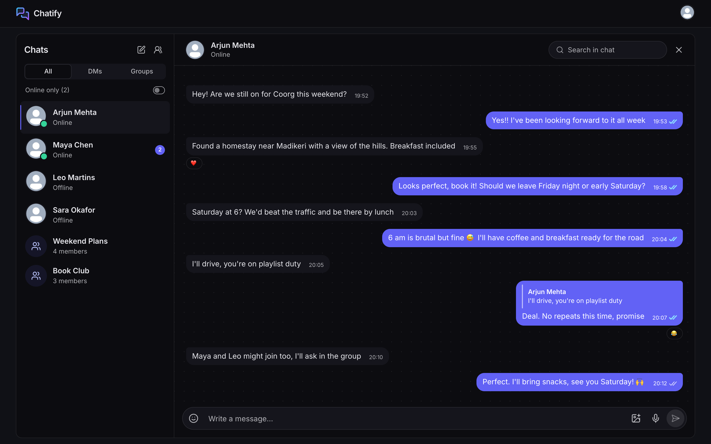
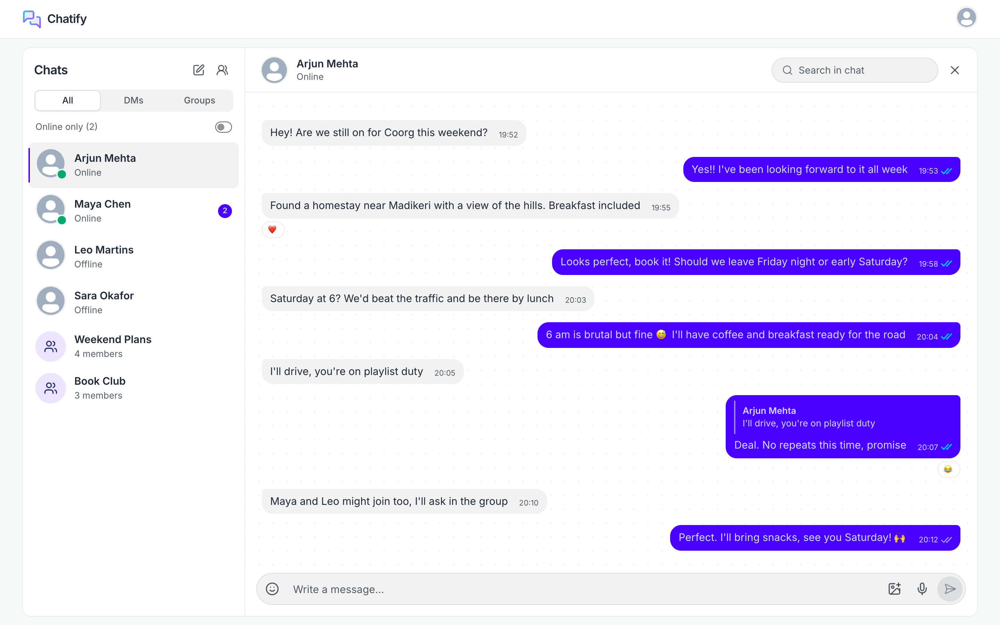
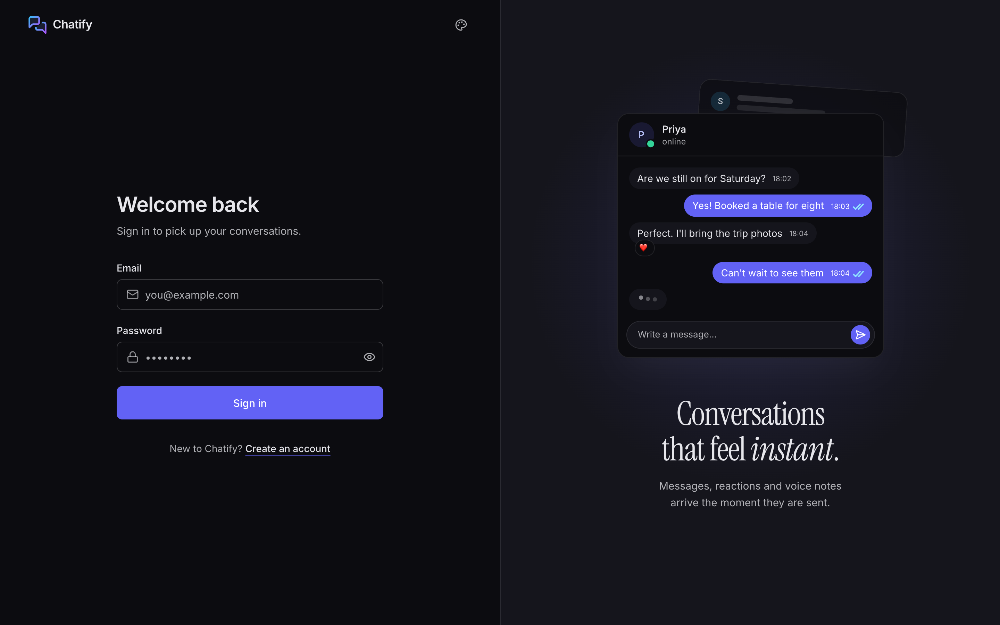
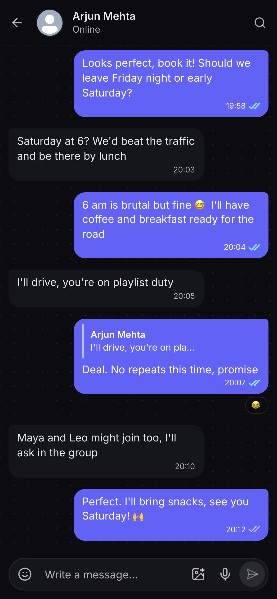

# 💬 Chatify

<div align="center">
  

  <p>A modern real-time chat application built with the MERN stack and Socket.io.</p>

  <a href="https://rajcodes-chatify.onrender.com/" target="_blank"><strong>🌐 Live Demo</strong></a>
</div>

---

## ✨ Features

### 💬 Messaging
- **Real-time messaging** — Instant message delivery powered by Socket.io
- **Voice notes** — Record and send audio messages with the built-in MediaRecorder
- **Image sharing** — Send and receive images in chat, powered by Cloudinary
- **Link previews** — Automatic OpenGraph previews for shared URLs
- **Emoji picker** — Rich emoji support in the message composer

### 👥 Conversations
- **Group chats** — Create groups, add members, and chat together
- **Threaded replies** — Swipe-to-reply on mobile, click-to-reply on desktop
- **Message forwarding** — Forward messages to multiple users or groups at once
- **Infinite scrolling** — Cursor-based pagination for seamless message loading at scale

### ✏️ Message Management
- **Edit messages** — Modify your sent messages with an inline editor
- **Delete messages** — Delete for yourself or for everyone (WhatsApp-style)
- **Reactions** — React to any message with quick emoji reactions (👍 ❤️ 😂 😮 😢 🙏)
- **Read receipts & typing indicators** — Real-time blue ticks and typing status

### 🔐 Auth & Security
- **Secure authentication** — Signup, login, and logout with JWT & HTTP-only cookies
- **Single active session** — Prevents concurrent logins from multiple devices
- **Online presence** — See who's currently active with real-time last seen timestamps

### 🎨 UI & Experience
- **10 curated themes** — Choose from a handpicked set of DaisyUI themes including the custom Chatify dark theme
- **Responsive design** — Works seamlessly on desktop, tablet, and mobile
- **Profile management** — Update your display picture, view other users' profiles
- **PWA support** — Installable as a Progressive Web App with push notifications
- **In-chat search** — Search through messages within a conversation

## 📸 Screenshots

<table>
  <tr>
    <td width="50%" align="center" valign="top">
      
      <br />
      <sub>Light theme</sub>
    </td>
    <td width="50%" align="center" valign="top">
      
      <br />
      <sub>Sign-in page</sub>
    </td>
  </tr>
</table>

<p align="center">
  
  <br />
  <sub>On a phone, the open chat fills the screen</sub>
</p>

## 🛠️ Tech Stack

| Layer              | Technology                                    |
| ------------------ | --------------------------------------------- |
| **Frontend**       | React 18, Vite, TailwindCSS, DaisyUI, Zustand |
| **Backend**        | Node.js, Express.js                           |
| **Database**       | MongoDB (Mongoose)                            |
| **Real-time**      | Socket.io                                     |
| **Auth**           | JSON Web Tokens (JWT)                         |
| **Media Storage**  | Cloudinary                                    |
| **Push Notifications** | Web Push (VAPID)                          |
| **PWA**            | Workbox (vite-plugin-pwa)                     |

## 📋 Prerequisites

Make sure you have the following installed:

- [Node.js](https://nodejs.org/) (v18 or higher)
- [MongoDB](https://www.mongodb.com/) (local instance or [MongoDB Atlas](https://www.mongodb.com/atlas) cloud)
- A [Cloudinary](https://cloudinary.com/) account (free tier works)

## 🚀 Getting Started

### 1. Clone the repository

```bash
git clone https://github.com/Ra-jj/chatify.git
cd chatify
```

### 2. Set up environment variables

Create a `.env` file inside the `backend/` directory:

```bash
touch backend/.env
```

Add the following variables:

```env
MONGODB_URI=your_mongodb_connection_string
PORT=5001
JWT_SECRET=your_jwt_secret_key

CLOUDINARY_CLOUD_NAME=your_cloud_name
CLOUDINARY_API_KEY=your_api_key
CLOUDINARY_API_SECRET=your_api_secret

VAPID_PUBLIC_KEY=your_vapid_public_key
VAPID_PRIVATE_KEY=your_vapid_private_key

NODE_ENV=development
```

Create a `.env` file inside the `frontend/` directory:

```bash
touch frontend/.env
```

Add the following variable:

```env
VITE_VAPID_PUBLIC_KEY=your_vapid_public_key
```

> **Tip:** Generate VAPID keys using `npx web-push generate-vapid-keys`

### 3. Install dependencies

```bash
# Install backend dependencies
cd backend
npm install

# Install frontend dependencies
cd ../frontend
npm install
```

### 4. Run in development mode

Open **two terminals**:

```bash
# Terminal 1 — Start the backend
cd backend
npm run dev
```

```bash
# Terminal 2 — Start the frontend
cd frontend
npm run dev
```

The app will be available at `http://localhost:5173`

### 5. Build for production

From the project root:

```bash
npm run build
npm start
```

This installs all dependencies, builds the frontend, and serves everything from the Express backend on port `5001`.

## 📁 Project Structure

```
chatify/
├── backend/
│   └── src/
│       ├── controllers/     # Route handlers (auth, messages, groups)
│       ├── lib/             # DB connection, Cloudinary, Socket.io, utilities
│       ├── middleware/       # JWT authentication and rate limiting
│       ├── models/           # Mongoose schemas (User, Message, Group)
│       ├── routes/           # Express route definitions
│       └── index.js          # Server entry point
├── frontend/
│   └── src/
│       ├── components/       # Reusable UI components
│       ├── constants/        # Theme definitions
│       ├── lib/              # Axios instance, push notifications, utilities
│       ├── pages/            # Route-level page components
│       ├── store/            # Zustand state management
│       ├── sw.js             # Service worker (PWA + push)
│       ├── App.jsx           # Root component with routing
│       └── main.jsx          # Application entry point
└── package.json              # Root scripts (build & start)
```

## 📄 License

This project is licensed under the MIT License. See the [LICENSE](LICENSE) file for details.
